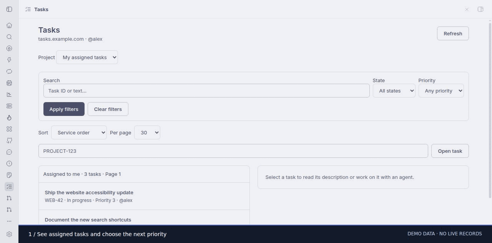

# Bureaucat for BB

Browse and manage Bureaucat tasks through the `bcat` CLI. Open **Tasks** in BB
navigation, in a thread's right-panel **New tab** menu, or from the new-thread
composer's panel actions. The sidebar switches between the list and task details.

## Features

- Assigned tasks and project tasks, text search, state and priority filters.
- Project filters for labels, assignee or creator (username or user UUID), workflow state
  UUID and an inclusive UTC creation-date range.
- Sorting by title, priority, state, task number or comment count, ascending or
  descending. Project lists also support creation and update dates. Sorting and
  filtering cover the complete source list before pagination, not just one page.
- Configurable page size (15, 30, 50 or 100 in the UI; 1–100 through the CLI).
- Direct task lookup by ID and task information with user/state/label IDs,
  creator, creation/update dates and comment count.
- Task creation with initial workflow state, assignees and labels; edits to title,
  description, priority or state; explicit comment posting.
- Prepare an agent draft with a task link and a command to read current details.

The agent action opens BB's composer. Select the intended BB project/repository
and send the draft to start work. No task updates or comments are posted automatically.

## Setup

Requires BB >=0.47 and Plugin SDK >=0.6.79.

1. Run `npm ci --include=dev`, then `bb plugin build` in this directory.
2. Install the plugin with `bb plugin install . --yes`.
3. Install the Bureaucat CLI on the chosen BB machine. Upstream releases name it
   `bureaucat`; `bcat` is also supported. Optionally use
   `python3 scripts/install-cli.py --destination /path/to/plugin-host-storage/bin/bcat`.
   This downloads an immutable official release and verifies its SHA-256. Keep
   runtime binaries in BB plugin-owned host storage, outside the source checkout.
4. Authenticate interactively in a private terminal with
   `bcat login --url https://tasks.example.com`. Supply your personal access token
   at its prompt. Existing valid CLI credentials can be reused.
5. In plugin settings set `baseUrl` to your Bureaucat URL and `binaryPath` to the
   CLI executable. The binary defaults to `bcat` on the host daemon's PATH.
6. Set `hostId` when multiple BB machines are connected. A sole connected machine
   is selected automatically. Verify with `bb bureaucat whoami`.

The URL setting is required. Changing it redirects the CLI to that service while
using the existing CLI-owned token; select the matching CLI account/configuration.
No service domain, credential, account identity or local checkout path is shipped
as a default.

## Commands

All commands accept `--machine ID` and `--json`. Use subcommand `--help` for flags.

- Reads: `whoami`, `projects [--q TEXT --page N]`, `mytasks`, `tasks PROJECT`,
  and `view PROJECT-123`.
- Lists: `--q TEXT`, `--state started`, `--priority 0`, `--label NAME`,
  `--sort title`, `--direction asc`, `--page N`, `--per-page 30`.
- Project lists additionally accept `--assigned-to USER`, `--created-by USER`,
  `--state-id UUID`, `--from-date YYYY-MM-DD` and `--to-date YYYY-MM-DD`.
- Sort keys: `default`, `title`, `priority`, `state`, `number`, `comments`,
  `created`, `updated`. Assigned lists do not include labels or timestamps, so choose a
  project for label filtering or date sorting. The CLI defaults to ascending; the UI initially
  selects descending for priority, comment count and dates.
- Writes require `--yes`: `create PROJECT --title TEXT`,
  `update PROJECT-123` and `comment PROJECT-123 "Comment text"`.
- Creation accepts `--description`, `--priority`, `--state-id`, and comma-separated
  `--assignees` and `--labels` UUID lists. Updates accept title, description,
  priority and state. Priorities: 0 none, 1 low, 2 medium, 3 high, 4 urgent.

The UI puts advanced filters and creation fields in expandable sections. Use
Task information to find identifiers, or obtain them from Bureaucat; the CLI
has no dedicated project member/state/label discovery commands.

## Sorting and filtering constraints

The reviewed upstream API no longer consumes the legacy scalar filters emitted
by its CLI. The plugin therefore fetches unfiltered CLI pages and applies filters
and sorting itself. It does not read the token or call the API directly.
See [upstream research](UPSTREAM_FEATURES.md) for the source references and other
Bureaucat features that are not exposed by the CLI.

Filtered/sorted views scan at most **5,000 source tasks**, with at most four
concurrent read subprocesses and a 45-second overall deadline. Above the cap the
plugin refuses the operation; it never presents a partially sorted result as
complete. Use the default paginated view or the Bureaucat website for larger
sources. A changed total, duplicate task or incomplete scan requires a refresh.
Concurrent edits that preserve counts are still subject to the API's offset
pagination consistency limits. No cross-page snapshot guarantee is available.

Default lists keep the service's normal pagination and ordering. Every filtered
or sorted page is read fresh. Search is case-insensitive substring matching over
ID and title; project searches also include description text. Labels use case-insensitive name matching. Dates
refer to creation time in UTC and include both boundary dates.

## Credentials and execution

A typed BB host entry runs the CLI on the selected machine using argument arrays,
closed stdin, a 25-second per-process timeout and a 1 MiB per-process output cap.
Every subprocess sets `BUREAUCAT_URL` from the validated plugin URL setting.
Credentials remain owned by the CLI, normally in
`~/.config/bureaucat/config.json`, or via `BUREAUCAT_CONFIG_PATH` /
`BUREAUCAT_TOKEN`. The plugin does not read, store, log or return their values.

Responses are validated and descriptions are limited to 24,000 characters.
Larger descriptions fail validation instead of being silently truncated. HTML
is sanitized before rendering. Updates preserve the original description markup
and allow empty descriptions; the upstream CLI trims descriptions on creation.

Writes are not retried. After an ambiguous write failure, read the task before
trying again. No deletion, existing-comment reads, assignment changes after
creation, attachment operations or workflow discovery are exposed by the CLI.
Use Bureaucat's website for those operations.

## Development and rollback

Run `npm run check`, `npm test`, `bb plugin build`, then
`bb plugin reload bureaucat`. Tests cover complete-result sorting/filtering,
source limits, changing pages, command validation, write gating, URL validation,
sidebar navigation, controls, sanitized descriptions and agent drafts.
Live verification uses read operations only; write paths use fixtures.

Release metadata pins the official CLI archives for Linux/macOS amd64/arm64.
Review CLI changes before updating the immutable tag and digests in `release.json`.
No runtime download belongs in source control.

Disable with `bb plugin disable bureaucat`. Reinstall a previous source path to
roll back while preserving the same plugin ID and its settings/state. CLI login
and Bureaucat tasks are unaffected by plugin disable/reload.

## Collection install

```sh
bb plugin install git:https://github.com/oddship/bb-plugins.git@^0.2.0 --plugin bureaucat --tag-prefix bureaucat/
```

## Walkthrough



[Step 1](screenshots/step-1.jpg) · [Step 2](screenshots/step-2.jpg) · [Step 3](screenshots/step-3.jpg)

Captured from the installed plugin UI. Service integrations use visibly labeled
browser-only demo data; no live work records are shown. See the collection
[recording notes](../../scripts/MARKETPLACE_CAPTURES.md) for reproduction.
