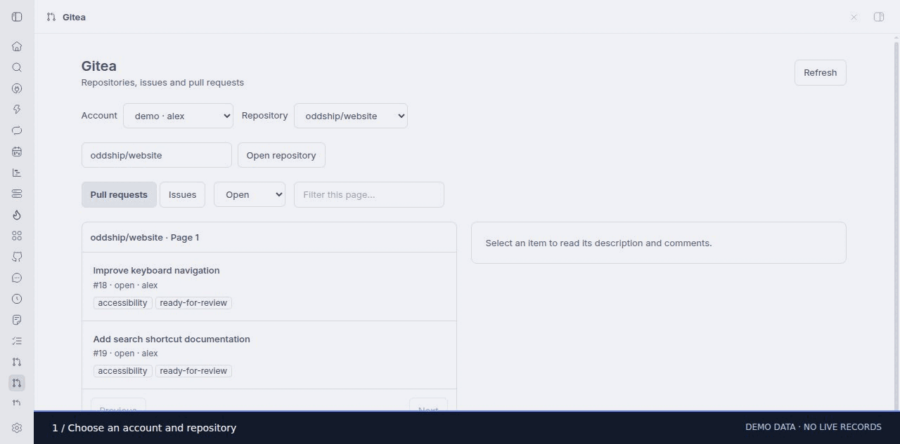

# Gitea for BB

Browse Gitea repositories, issues and pull requests in BB using the **tea** CLI and its existing logins. The Gitea navigation page includes account and repository selection, open/closed filters, pagination, current-page search, descriptions, comments, and an action that drafts a new agent prompt for the selected item.

## Requirements and setup

- BB 0.47+ with Plugin SDK 0.6.79+.
- A current tea CLI with `tea api` on the selected machine’s PATH.
- Authenticate on that machine with `tea login add`. Credentials remain managed by tea; the plugin never reads or stores tokens.

```sh
npm ci
npm run check
npm test
bb plugin build
bb plugin install . --yes
```

Open **Gitea** from BB’s navigation. A single connected machine and a single tea login are selected automatically. For multiple machines set `bb plugin config oddship-gitea set hostId <machine-id>`; optionally set `login` to the desired tea login name. CLI calls also accept `--machine` and `--login`. The plugin runs tea through its host entry on the specified machine, including when BB’s server is elsewhere. It never interprets a remote path on the server.

## Commands

```sh
bb oddship-gitea logins --json
bb oddship-gitea repos --login gitea.example.org --page 1 --json
bb oddship-gitea issues owner/repo --state open --json
bb oddship-gitea prs owner/repo --state all --json
bb oddship-gitea view owner/repo 42 --kind pulls --json
```

Lists fetch 30 rows per page; `--page` advances repository and item listings. Detail views include the first 30 issue conversation comments and bounded descriptions. PR review threads and CI checks are not included. The repository input allows opening accessible repositories outside the currently loaded repository pages. Search filters the current page, not the whole server.

The integration reads Gitea data. “Work on this with an agent” opens BB’s new-thread composer with a draft and the current project when one is selected; choose the appropriate checkout before submitting. It does not send an agent message automatically. Use tea directly for PR creation, review, merging and issue changes when requested.

Requests use `execFile` with argument arrays, explicit GET endpoints, a 20 second timeout, cancellation, and a 4 MiB subprocess output cap. The plugin exposes no arbitrary tea command or arbitrary endpoint RPC. Invalid repository names, indices and pagination fail schema validation. API error bodies and subprocess diagnostics are not forwarded to the frontend, avoiding credential-bearing errors. Descriptions and comments render as escaped text; external links accept HTTP(S) only.

## Development

From `plugins/gitea`, run `npm run check`, `npm test`, `bb plugin build`, then `bb plugin reload oddship-gitea`. Tests cover the real SDK host/server contracts, CLI validation, normalizing and filtering Gitea responses, safe URLs, missing/invalid API output, and the frontend navigation and stale-response handling. Tests use fixtures and do not require a Gitea account. For a live read-only check, run `bb oddship-gitea logins`, list an accessible repository, and open an issue or pull request in the Gitea navigation page.

## Collection install

```sh
bb plugin install git:https://github.com/oddship/bb-plugins.git@^0.1.0 --plugin oddship-gitea --tag-prefix oddship-gitea/
```

## Walkthrough



[Step 1](screenshots/step-1.jpg) · [Step 2](screenshots/step-2.jpg) · [Step 3](screenshots/step-3.jpg)

Captured from the installed plugin UI. Service integrations use visibly labeled
browser-only demo data; no live work records are shown. See the collection
[recording notes](../../scripts/MARKETPLACE_CAPTURES.md) for reproduction.
