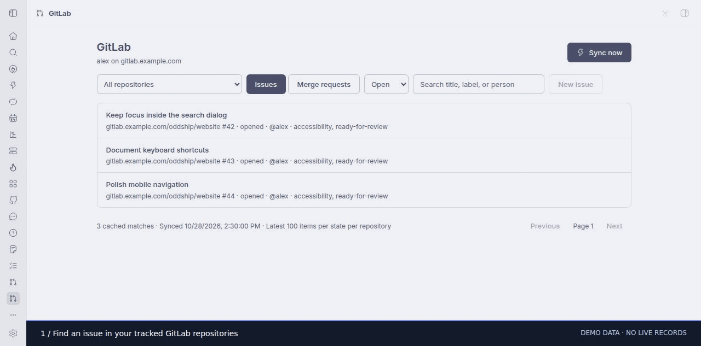

# GitLab for BB

A glab-based GitLab plugin modeled on BB's GitHub integration. Browse issues and
merge requests in BB, read descriptions and comments, create issues, post comments,
close/reopen items, change assignees/reviewers, and start agent work or reviews.
The navigation page includes repository, state, and text filters and pagination.
Cached items are also available as composer mentions and through `bb oddship-gitlab`.

## Install and configure

Requires BB 0.47+, Plugin SDK 0.6.79+, Node for local development, and `glab` on
the BB **server**. Authenticate glab there with `glab auth login --hostname HOST`.
The plugin never stores or handles a GitLab token directly.

Run `npm ci`, `bb plugin build`, then `bb plugin install . --yes` in this directory.
Open **GitLab** in BB navigation, at `/plugins/oddship-gitlab/browse`.

In Settings → Plugins → GitLab, choose `hostname` and add `extraRepos` such as
`team/project` or `gitlab.example.com/team/subgroup/project`. Repository URLs and
SSH remotes are accepted too. Extra repositories are comma/newline-separated;
unnamed hosts default to `hostname`. Attached BB projects with matching GitLab
remotes are discovered automatically. Choose `defaultProject` to enable agent
work for repositories that do not have an attached project. Use a project whose
checkout matches the repository; that project owns the agent execution host.

`glabPath` overrides the executable (default `glab`). `syncMinutes` controls the
background refresh interval (1–60 minutes, default 5). Settings apply to subsequent
requests; refresh the page after changing them, or use Sync now. Every API request
selects its GitLab hostname explicitly, so an unauthenticated gitlab.com entry does
not prevent use of a self-hosted instance.

## CLI

- `bb oddship-gitlab repos --json`
- `bb oddship-gitlab status --json`
- `bb oddship-gitlab sync --json`
- `bb oddship-gitlab issues --repo HOST/NAMESPACE/PROJECT --state all --json`
- `bb oddship-gitlab mrs --query bug --state opened --page 1 --json`
- `bb oddship-gitlab view HOST/NAMESPACE/PROJECT 7 --kind mr --json`

Lists read the cache; `view` reads fresh data. Use `--help` for available options.
Issue and merge request mention providers answer `@` and `#` in BB's composer.
The page's Start work / Start review action creates and opens a BB thread. It asks
the agent to investigate locally and not push or post without user authorization.

## Data and limits

`glab api` runs with argument arrays, no shell, a 30-second timeout, a 4 MiB output
limit, and plugin disposal cancellation. Writes use JSON through stdin. Repository
paths, RPC inputs and API responses are validated. Only tracked repositories can
be read or changed through item RPCs.

The plugin's SQLite cache stores the latest 100 issues per state and 100 merge
requests per state, with up to 50 tracked repositories. Each repository refresh
commits atomically; an API failure keeps that repository's previous cache. The UI
and CLI show sync failures and cache age. Lists show 50 matches per page. Text
search matches titles, numbers, authors, assignees, and labels.

Descriptions are limited to 50,000 characters; notes to 20,000 each. Detail reads
include the latest 100 notes; the people picker shows the first 100 members.
The CLI refuses output over 900 KB instead of exceeding BB's response limit.
The browser renders descriptions/comments with BB's Markdown component.

This plugin does not merge MRs, show repository diffs inside the page, or add
GitLab status to BB's GitHub-specific PR row integration. It uses server-local
credentials; it does not use glab installations on enrolled execution hosts.

## Development and verification

- `npm run check`: strict source typechecking.
- `npm test`: API transport, repository identity, SQLite cache, RPC/CLI validation,
  mutations, failure retention, agent action, disposal, and frontend behavior.
- `bb plugin build`: SDK-compatible server and app bundles.
- `bb plugin reload oddship-gitlab`: load rebuilt code after development changes.

See [VERIFICATION.md](VERIFICATION.md) for validation commands and the live verification scope.
Disable with `bb plugin disable oddship-gitlab`; source remains in this directory.

## Collection install

```sh
bb plugin install git:https://github.com/oddship/bb-plugins.git@^0.1.0 --plugin oddship-gitlab --tag-prefix oddship-gitlab/
```

## Walkthrough



[Step 1](screenshots/step-1.jpg) · [Step 2](screenshots/step-2.jpg) · [Step 3](screenshots/step-3.jpg)

Captured from the installed plugin UI. Service integrations use visibly labeled
browser-only demo data; no live work records are shown. See the collection
[recording notes](../../scripts/MARKETPLACE_CAPTURES.md) for reproduction.
