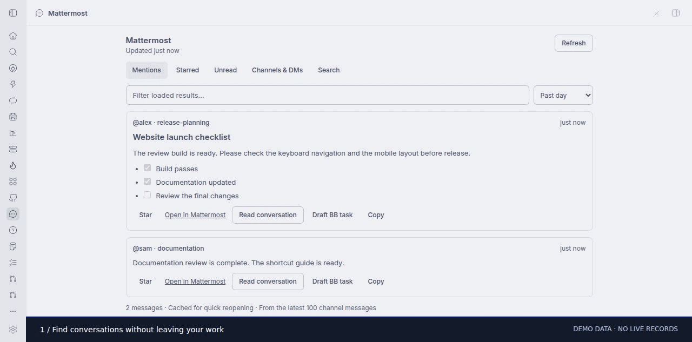

# Mattermost for BB

Read work conversations beside your BB chat and bring useful context into your work.

- **This thread:** conversations explicitly linked to the current BB thread, plus a search suggestion from its title (falling back to project and branch).
- **Quote in BB:** append a message, author, timestamp and source ID to your current draft without sending it.
- **Link:** keep a conversation with this thread across reloads. Agents can retrieve it through native tools.
- **Draft BB task:** open the new-thread composer with quoted source material and an investigation prompt for you to review.
- **Search:** full Mattermost search, including from:, in: and date modifiers.
- Mentions, unread channels, joined channels and DMs, channel history and conversations.
- Sort Channels & DMs by newest activity, oldest activity, name A–Z or name Z–A.
  Your choice is remembered and applies immediately to cached results.
- Channel activity grouped by conversation, with latest replies and participant previews.
- Original message separated from chronological replies, source-message highlighting,
  and earlier-reply expansion (100 → 200 → 500 → 1,000).
- Back navigation restores the source filter and scroll position.
  Channel grouping uses the saved messages, without a network request per conversation.
- Markdown rendering for messages and reply previews, with tables and code blocks that fit narrow panels.
- Inline images with enlargement, audio/video players, document previews, and downloads through BB.
- **Starred:** save conversations across BB threads; pin the important ones at the top.
- Source links, copying, filtering and per-thread navigation restoration.

## Install

```sh
bb plugin install git:https://github.com/oddship/bb-plugins.git@^0.4.0 --plugin mattermost --tag-prefix mattermost/
```

## Setup

Install [mattermost-cli](https://github.com/rhnvrm/mattermost-cli) on an enrolled BB host and run `mm login` there. Verify `mm whoami`.

    npm install --include=dev
    bb plugin build
    bb plugin install . --yes
    bb plugin config mattermost set hostId <host-id>
    bb plugin config mattermost set serverUrl https://your-mattermost.example

Open the right panel in any thread and select Mattermost. The full page is also
available in the left navigation or at /plugins/mattermost/inbox.
Credentials remain in mm's existing credential store on the selected host.

## Caching and freshness

Snapshots persist in plugin-owned SQLite across reloads. Freshness windows:
60 seconds for mentions, unread, channels' messages and conversations;
2 minutes for search; 10 minutes for the joined-channel directory.
Expired snapshots return immediately and refresh in the background. All open
panels receive an update signal after a refresh. A failed refresh keeps saved
results visible, labels the failure and backs off for 30 seconds.
Refresh explicitly waits for a new read and keeps current content on screen.

The cache is keyed by host and validated request, limited to 200 entries and
roughly 24 MiB of JSON. Snapshots older than seven days are not served and are
pruned on writes. Session memory is bounded separately. Identical concurrent
reads share one CLI call; at most two mm processes run at once. Queued and
active work is cancelled on reload. Visible panels check every minute;
there is no perpetual background polling when the panel is closed.

A first uncached read still waits for mm and the work server, up to 25 seconds.
Channel reads are bounded to 100 posts and searches to 50 results. Conversations
start with the original message and latest replies, and can expand to 1,000 posts.
Missing earlier replies are labeled when the root provides a reply count.
Channel cards show only activity within the loaded message window, and explicitly
label reply previews when the original message is outside that window.
Attachments are fetched using mm on the configured host and relayed through BB;
the browser does not need Mattermost credentials. Images load lazily and enlarge
in BB's image viewer. Audio/video support range requests and seeking. PDF and text
previews open on demand in a sandbox; other file types download through BB's
native download/share flow. Document preview availability depends on the browser.
HTML, SVG and executable types are served as downloads, never active BB pages.

The relay supports files up to 64 MiB and streams large files in 1 MiB chunks.
This is a served/cached-file limit, not a cap on the upstream download:
mm currently offers neither a maximum-size option nor a metadata-only file
command, and downloads the whole file before the plugin can inspect it. Its
network transfer and temporary writes can therefore exceed 64 MiB before
rejection. Attachments whose message metadata already exceeds the limit are
sent directly to the original-message link in the UI.

Files up to 4 MiB are cached in the plugin database (64 MiB and 64 files total,
seven-day expiry). Host temporary downloads are bounded separately and removed
with the host worker. Larger files can be opened from the original Mattermost
message. A failed transfer offers retry and download/source fallbacks.
Reading does not mark messages read and the plugin never posts to Mattermost.

## Personal starred and pinned conversations

Use Star on a conversation card or Star conversation in the reader. Starred
conversations appear in the Starred view across all BB threads and clients using
this Mattermost host. Pin saves a conversation and puts it first. Unpin keeps
the star; Unstar removes it from the saved list.

These are personal BB bookmarks, independent of the shared Mattermost channel
pins and independent of conversations linked to a particular BB thread.
They persist in plugin-owned SQLite, with a limit of 500 saved conversations
per host. Stars and pins never post or change anything in work Mattermost.

## Agent integration

The native **mattermost_read** tool supports cached reads and full search.
**mattermost_context** returns the conversations linked to the agent's current
BB thread. Linked IDs and bounded cached excerpts are supplied when BB constructs
the agent session. Existing sessions acquire new tools and standing instructions
at BB's next session setup; quoting into the draft works immediately.
Message content is untrusted source material, with authors and IDs preserved.

CLI output includes fetchedAt, cache, refreshing, data and any refreshError:

    bb mattermost mentions
    bb mattermost unread
    bb mattermost channels
    bb mattermost messages <channel-id>
    bb mattermost thread <post-id>
    bb mattermost search 'in:work order exits'
    bb mattermost context
    bb mattermost mentions --refresh

## Development

    npm run typecheck
    npm test
    bb plugin build
    bb plugin dev

Tests cover stale cache behavior, offline fallback, host isolation, concurrent
reads, queue disposal, request validation, search, context quoting and navigation.
Additional checks cover actual filesystem attachment downloads, range requests,
binary caching in SQLite, MIME/path isolation, preview retries, Markdown attachment
URLs, personal stars/pins and reopening saved conversations.

## Walkthrough



[Step 1](screenshots/step-1.jpg) · [Step 2](screenshots/step-2.jpg) · [Step 3](screenshots/step-3.jpg)

Captured from the installed plugin UI. Service integrations use visibly labeled
browser-only demo data; no live work records are shown. See the collection
[recording notes](../../scripts/MARKETPLACE_CAPTURES.md) for reproduction.
