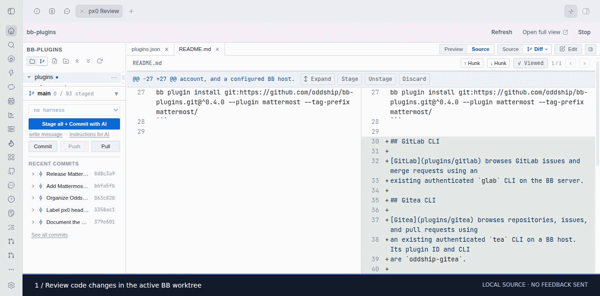

# px0 Review for BB

A BB side-panel review workbench powered by [rhnvrm/px0](https://github.com/rhnvrm/px0).
Open **Review code with px0** in any thread header, or choose **px0 Review**
from the side-panel actions. The header button shows a px0 tooltip on hover.
Empty workspaces show their actual directory and explain how to review an
existing repository. Select source or diff lines and choose **Send to
BB** to submit feedback to the existing BB thread.

The plugin runs the pinned fork build on the thread environment's host, binds
it to loopback, and uses authenticated BB Connect for remote clients. Binaries
are downloaded into plugin-owned storage and checked against release.json
SHA-256 digests. Source and release revision are pinned; upstream auto-update,
telemetry and native px0 agents are disabled. BB retains its provider, model,
account, approvals, conversation history and scheduling.

The fork allows only the exact BB parent origin, authenticates every request,
and explicitly permits the configured proxy origin for writes. Session tokens
are bootstrapped into HttpOnly cookies and stripped from the iframe URL.
Feedback messages validate the originating iframe and origin; the backend
checks that the BB environment still matches and queues messages if busy.
The viewer remains editable and supports Git actions.

## Development

Run `npm install`, `npm run check`, `npm test`, and `bb plugin build`.
Install with `bb plugin install . --yes`. The optional `binaryPath` setting
can point to a locally built fork for development. Release builds are pinned
in release.json. Run `scripts/build-fork.sh /path/to/px0` to build artifacts
and generate the release checksum manifest before publishing the fork release.

Fork source changes require a new immutable release and updated commit/checksum
pins in release.json before the default downloader uses them. Use binaryPath to
validate an unreleased build; never replace an existing release asset.

On the primary host, the plugin uses BB Connect’s server-host sharing API;
on enrolled hosts it declares shared ports through the host SDK. Desktop
clients reviewing another host also use Connect rather than a local URL.

Sessions heartbeat every 30 seconds, expire after three minutes, and stop on
thread archival/deletion or plugin teardown. A closed tab needs no permanent
background service. `bb px0-review status` and `stop` support diagnostics.
Stop and archival cancel pending launches as well as running viewers. Feedback
drafts are cleared when the viewer or workspace changes.

## Collection install

```sh
bb plugin install git:https://github.com/oddship/bb-plugins.git@^0.1.0 --plugin px0-review --tag-prefix px0-review/
```

## Walkthrough



[Step 1](screenshots/step-1.jpg) · [Step 2](screenshots/step-2.jpg) · [Step 3](screenshots/step-3.jpg)

Captured from the installed plugin UI. Service integrations use visibly labeled
browser-only demo data; no live work records are shown. See the collection
[recording notes](../../scripts/MARKETPLACE_CAPTURES.md) for reproduction.
